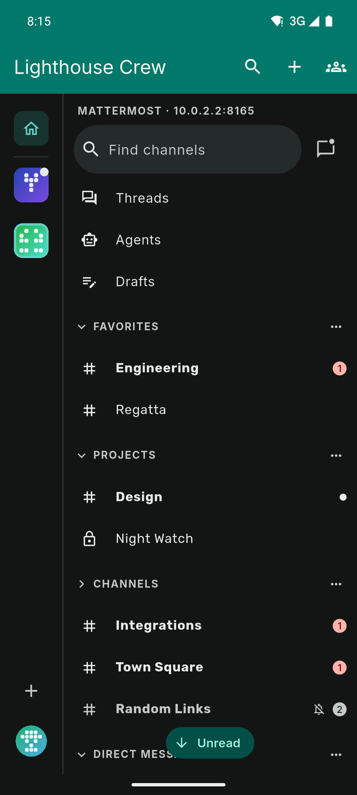
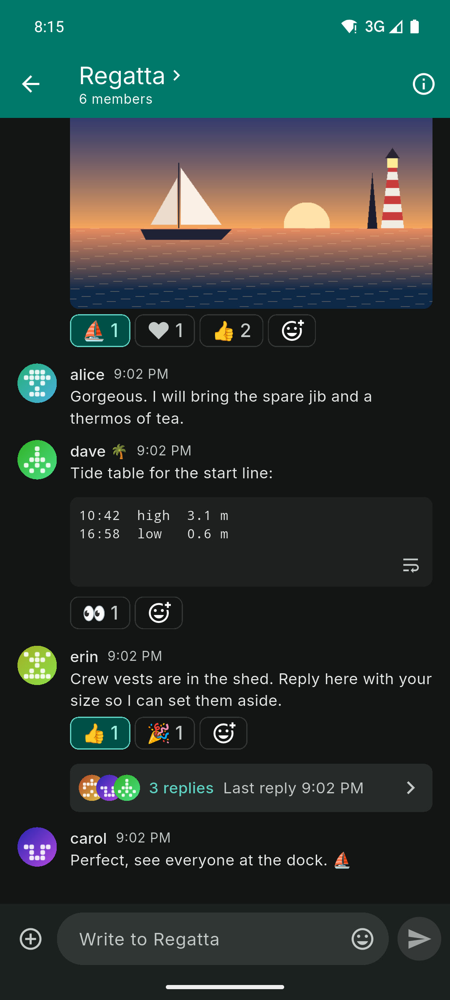
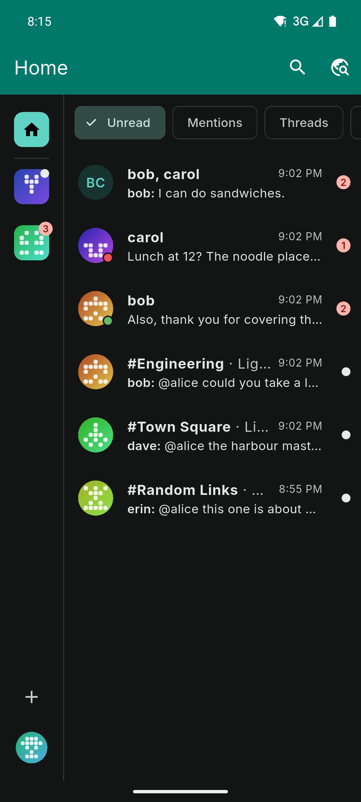
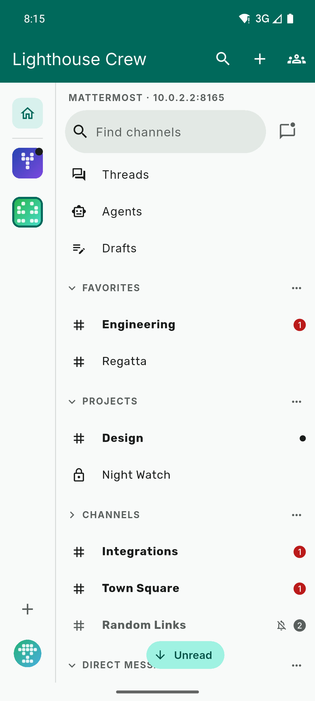
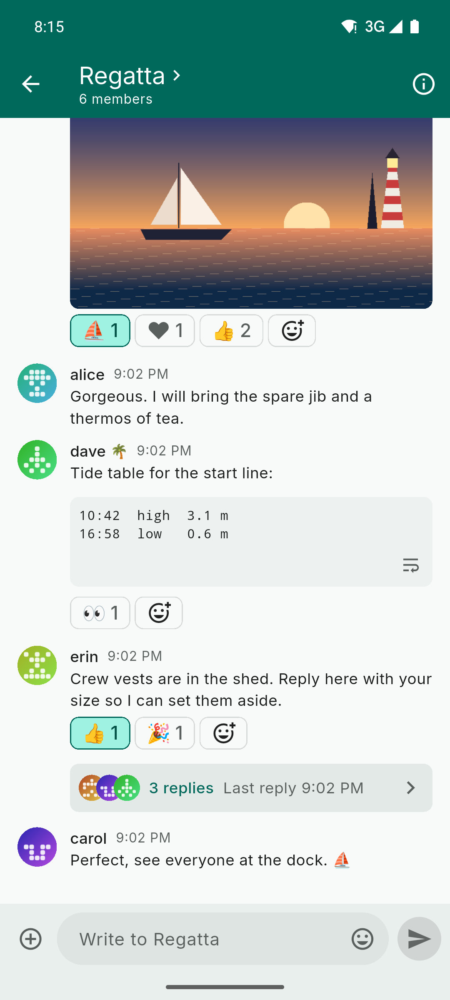
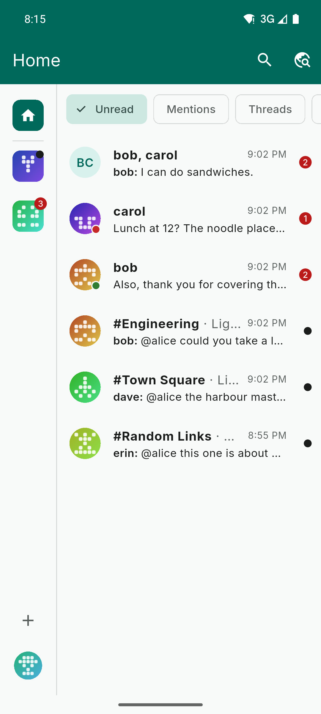
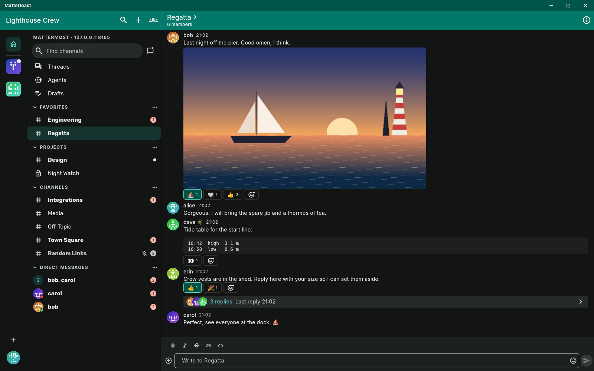
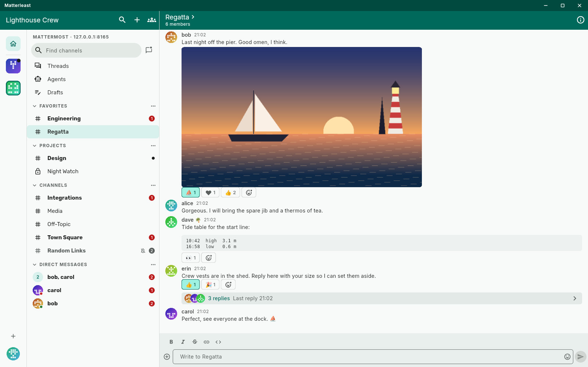

# Matterleast
Matterleast is an unofficial Android, Windows and Linux client (and an iOS build you make yourself) for [Mattermost](https://mattermost.com) servers that tries have a feel closer to Discord.

### Features
- Discord-style feel and navigation: you can swipe between chats, swipe on messages to react/reply etc.
- One Home inbox across all servers for unread messages, mentions, threads and saved messages
- Notifications without Google's push service via a background job
- Tablet layout in landscape
- Different theming options: Matterleast colours, your Mattermost theme or Material You

Other (obvious) features that exist: threads, reactions, file previews, sharing, search, custom emojis, bots, channel management and more.

### Screenshots (dark/light mode)
|                  Channel list                   |                  Conversation                   |                  Home inbox                   |
| :---------------------------------------------: | :---------------------------------------------: | :-------------------------------------------: |
|  |  |  |

|                  Channel list                   |                  Conversation                   |                  Home inbox                   |
| :---------------------------------------------: | :---------------------------------------------: | :-------------------------------------------: |
|  |  |  |

|                    Desktop (dark)                    |                    Desktop (light)                    |
| :--------------------------------------------------: | :---------------------------------------------------: |
|  |  |

### Warning about LLM-generated code

This app is significantly vibe-coded / created using LLMs. Most of its code has not been thoroughly reviewed by a human.

### Installation & updates
If you have [F-Droid](https://f-droid.org/) installed, you can add [my repository](https://github.com/xarantolus/fdroid). Make sure you have "Include anti-feature apps" enabled in settings. Then just search for "matterleast" in the F-Droid client to download. You will receive update notifications.

To add my repo, copy the following [link](https://raw.githubusercontent.com/xarantolus/fdroid/main/fdroid/repo?fingerprint=080898ae4309aeceb58915e43a4b7c4a3e2cda40c91738e2c02f58339ab2fbd7), then add this repository to your F-Droid client:

```
https://raw.githubusercontent.com/xarantolus/fdroid/main/fdroid/repo?fingerprint=080898ae4309aeceb58915e43a4b7c4a3e2cda40c91738e2c02f58339ab2fbd7
```

Alternatively, you can also scan this QR code:

<p align="center">
	
</p>


Alternatively, you can [download the APK file](https://github.com/xarantolus/matterleast/releases/latest/download/matterleast.apk), and install the app manually. Please note that you will not receive any update notifications when going this route. You can also watch this repository to get notified for releases.


### Desktop
- **Windows:** [download `matterleast-setup.exe`](https://github.com/xarantolus/matterleast/releases/latest/download/matterleast-setup.exe) and run it. The installer is unsigned, so SmartScreen shows "More info", then "Run anyway".
- **Linux:** [download `matterleast.flatpak`](https://github.com/xarantolus/matterleast/releases/latest/download/matterleast.flatpak), install it with `flatpak install --user matterleast.flatpak` and start Matterleast from your app menu (or `flatpak run io.github.xarantolus.matterleast`). Flatpak fetches the GNOME runtime from Flathub if needed; on GNOME the tray icon needs the AppIndicator extension.


### iOS
There is no App Store version. Each release goes to TestFlight for invited testers, and has an unsigned [`matterleast.ipa`](https://github.com/xarantolus/matterleast/releases/latest/download/matterleast.ipa), or you build the app yourself. What Apple asks for:

- **Free Apple Account:** build from Xcode on a Mac onto your own iPhone, or re-sign the release `.ipa` with a sideloading tool such as [AltStore](https://altstore.io) or [Sideloadly](https://sideloadly.io). Either way the app stops starting after **7 days** until you install it again, and a free account can have at most 3 such apps on a device.
- **Xcode Cloud and TestFlight** need the paid [Apple Developer Program](https://developer.apple.com/programs/) (99 USD a year, 25 Xcode Cloud hours a month included) and **a fork of this repository**: Xcode Cloud only connects to repositories you administer, and it needs your team in the project.

Building from Xcode (Mac with Xcode and [Flutter](https://docs.flutter.dev/get-started/install/macos/mobile-ios)):

1. `flutter pub get`, then open `ios/Runner.xcworkspace` in Xcode.
2. Runner target → Signing & Capabilities: pick your team (with a free account, "Personal Team") and change the Bundle Identifier to one of your own.
3. Turn on Developer Mode on the iPhone, plug it in and run `flutter run --release`.

Xcode Cloud (paid program):

1. Fork this repository, set your team and Bundle Identifier as above, and commit that in your fork.
2. In App Store Connect, create an app with that Bundle Identifier.
3. In Xcode: Product → Xcode Cloud → Create Workflow. Workspace `ios/Runner.xcworkspace`, scheme `Runner`, an Archive action with TestFlight (Internal Testing Only). Limit the start conditions to changes in `lib/`, `ios/` and `pubspec.*` to save hours.
4. [`ios/ci_scripts/ci_post_clone.sh`](ios/ci_scripts/ci_post_clone.sh) installs the Flutter version CI uses and the pods, and numbers each build. Install the build with the TestFlight app.

On iOS, notifications while the app is closed come when iOS lets the app check, which can be much less often than every 15 minutes. Stay connected, sharing into the app, Direct Share shortcuts and the Data Saver setting are Android only for now.

### Development
Matterleast is a Flutter app. [Install Flutter](https://docs.flutter.dev/get-started/install) with the Android toolchain, then:

```sh
git clone https://github.com/xarantolus/matterleast.git
cd matterleast
flutter pub get
flutter build apk --debug    # or: flutter run
```

Please commit generated code, and regenerate it after changing models, providers or the database. To do this, run `dart run build_runner build`.

There is also a dev container with Flutter, the Android SDK, an emulator and a local Mattermost test server, see [`.devcontainer/README.md`](.devcontainer/README.md).

### Limitations
- Calls, Playbooks and Boards are not supported, nor are Apps framework forms and message translation.
- Notifications don't go through Mattermost's push proxy, so new messages arrive when the app checks (about every 15 minutes) unless "Stay connected" is on.
- No macOS version, and no App Store release; see [iOS](#ios).
- The Windows and Linux app doesn't set you to "away" when you're inactive; you show as online while it runs, unless you pick a status yourself.
- The Windows and Linux composer has no spell check: Flutter offers none on desktop, and the packages for it ship their own word lists instead of using the system dictionary.
- On Linux, the app draws at most 60 frames per second, not in step with the screen: Flutter's Linux engine uses a fixed 60 Hz timer instead of the display's refresh, so a 90 or 120 Hz screen shows uneven scrolling.
- The Windows installer and the Linux Flatpak are unsigned and don't update themselves; the app says when a new release is out.
- Features that need a server setting, a plugin or a licence only show up when your server offers them.

### License
Matterleast is licensed under the [Apache License 2.0](LICENSE), the same licence as the official [Mattermost mobile app](https://github.com/mattermost/mattermost-mobile), whose behaviour it rebuilds without using its code.

The emoji table comes from Mattermost's emoji data (Apache 2.0), which is based on [emoji-data](https://github.com/iamcal/emoji-data) (MIT). The REST client is generated from the structure of Mattermost's published API description. Details are in [NOTICE](NOTICE).

Mattermost is a trademark of Mattermost, Inc. Matterleast is not affiliated with or endorsed by Mattermost, Inc., and the licence grants no rights to the Mattermost name or logo.
