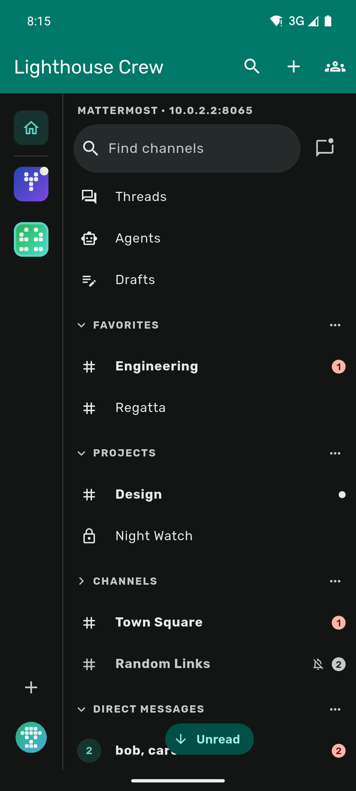
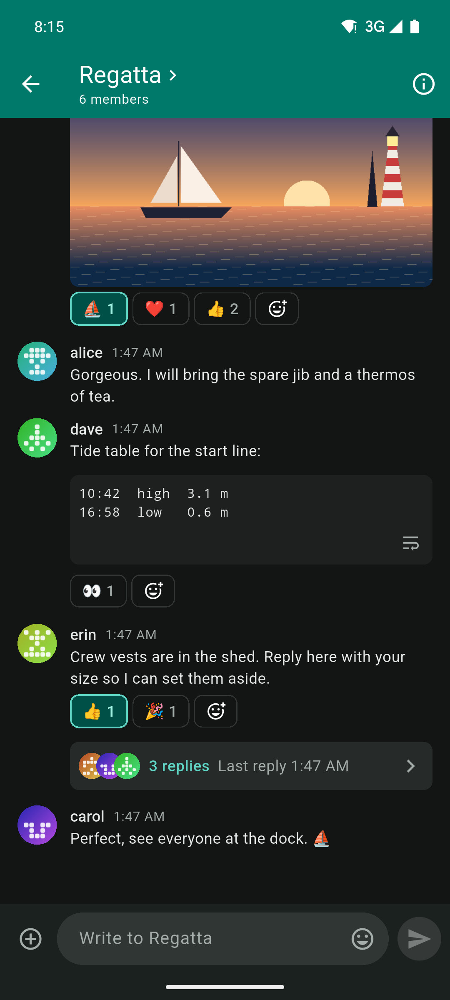
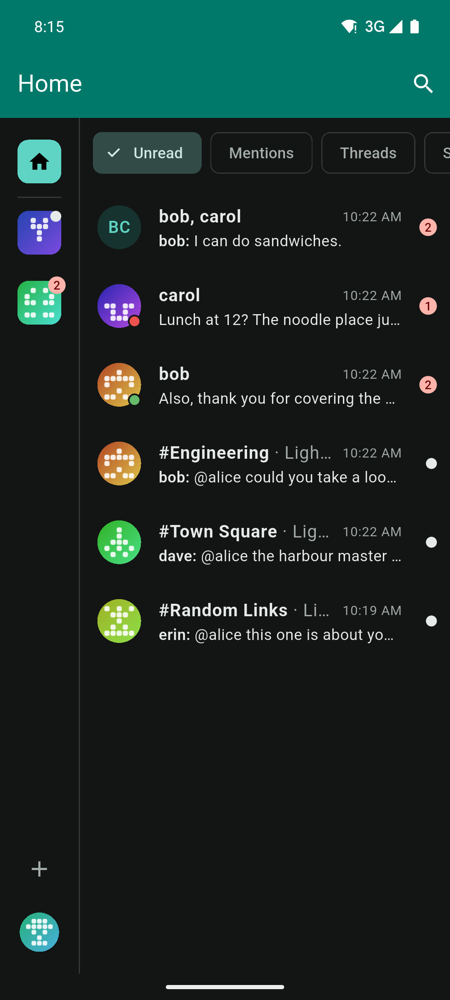
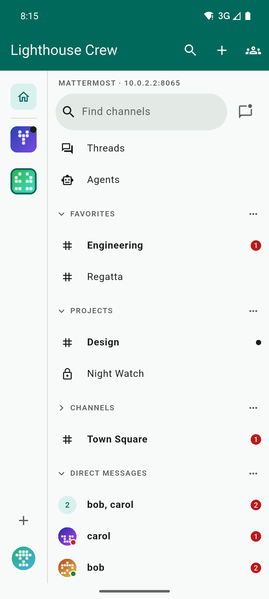
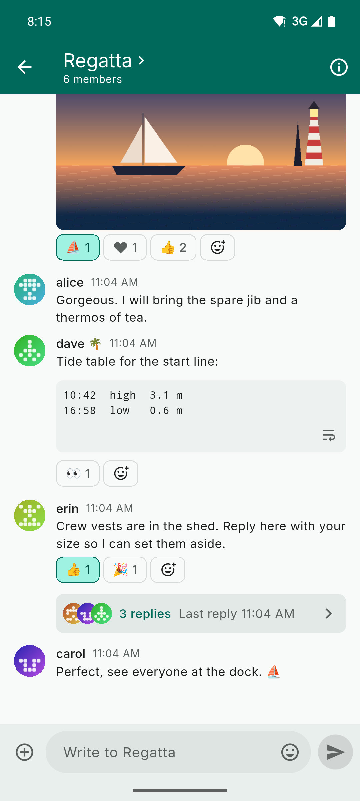
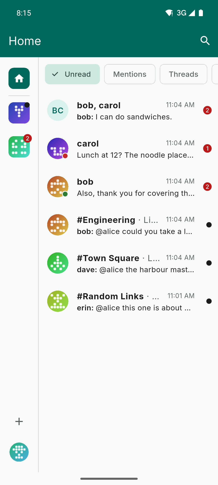

# Matterleast
Matterleast is an unofficial Android client for [Mattermost](https://mattermost.com) servers that tries have a feel closer to Discord.

### Features
- Discord-style feel and navigation: you can swipe between chats, swipe on messages to react/reply etc.
- One Home inbox across all servers for unread messages, mentions, threads and saved messages
- Notifications without Google's push service via a background job
- Tablet layout in landscape
- Different theming options: Matterleast colours, your Mattermost theme or Material You

Other (obvious) features that exist: threads, reactions, file previews, sharing, search, custom emojis, bots, channel management and more.

### Screenshots (dark/light mode)
|                  Channel list                   |                  Conversation                   |                  Home inbox                   |
| :---------------------------------------------: | :---------------------------------------------: | :-------------------------------------------: |
|  |  |  |

|                  Channel list                   |                  Conversation                   |                  Home inbox                   |
| :---------------------------------------------: | :---------------------------------------------: | :-------------------------------------------: |
|  |  |  |

### Warning about LLM-generated code

This app is significantly vibe-coded / created using LLMs. Most of its code has not been thoroughly reviewed by a human.

### Installation & updates
If you have [F-Droid](https://f-droid.org/) installed, you can add [my repository](https://github.com/xarantolus/fdroid). Make sure you have "Include anti-feature apps" enabled in settings. Then just search for "matterleast" in the F-Droid client to download. You will receive update notifications.

To add my repo, copy the following [link](https://raw.githubusercontent.com/xarantolus/fdroid/main/fdroid/repo?fingerprint=080898ae4309aeceb58915e43a4b7c4a3e2cda40c91738e2c02f58339ab2fbd7), then add this repository to your F-Droid client:

```
https://raw.githubusercontent.com/xarantolus/fdroid/main/fdroid/repo?fingerprint=080898ae4309aeceb58915e43a4b7c4a3e2cda40c91738e2c02f58339ab2fbd7
```

Alternatively, you can also scan this QR code:

<p align="center">
	
</p>


Alternatively, you can [download the APK file](https://github.com/xarantolus/matterleast/releases/latest/download/matterleast.apk), and install the app manually. Please note that you will not receive any update notifications when going this route. You can also watch this repository to get notified for releases.


### Desktop
- **Windows:** [download `matterleast-setup.exe`](https://github.com/xarantolus/matterleast/releases/latest/download/matterleast-setup.exe) and run it. The installer is unsigned, so SmartScreen shows "More info", then "Run anyway".
- **Linux (experimental):** [download `matterleast-linux-x64.tar.gz`](https://github.com/xarantolus/matterleast/releases/latest/download/matterleast-linux-x64.tar.gz) and unpack it. Then run `./install.sh` inside the unpacked folder; it installs for your user only, without root (app, launcher entry, icon and the `mmauth://` handler), and `./uninstall.sh` removes it again. It needs GTK 3, libsecret with a running keyring (GNOME Keyring or KWallet), libayatana-appindicator3 and WebKitGTK 4.1.
  ```sh
  tar xzf matterleast-linux-x64.tar.gz
  cd matterleast && ./install.sh
  ```
  Known gaps: it's experimental. Without a running, unlocked keyring the app can't save your sign-in and says so. The tray icon needs the AppIndicator extension on GNOME. Single sign-on needs the `mmauth://` handler that `install.sh` registers. Videos open in your system player. The unread count shows on the icon in docks that support it.


### Development
Matterleast is a Flutter app. [Install Flutter](https://docs.flutter.dev/get-started/install) with the Android toolchain, then:

```sh
git clone https://github.com/xarantolus/matterleast.git
cd matterleast
flutter pub get
flutter build apk --debug    # or: flutter run
```

Please commit generated code, and regenerate it after changing models, providers or the database. To do this, run `dart run build_runner build`.

There is also a dev container with Flutter, the Android SDK, an emulator and a local Mattermost test server, see [`.devcontainer/README.md`](.devcontainer/README.md).

### Limitations
- Calls, Playbooks and Boards are not supported, nor are Apps framework forms and message translation.
- Notifications don't go through Mattermost's push proxy, so new messages arrive when the app checks (about every 15 minutes) unless "Stay connected" is on.
- Android only; there is no iOS or desktop version. These are however possible to support in the future, as this is a Flutter app.
- Features that need a server setting, a plugin or a licence only show up when your server offers them.

### License
Matterleast is licensed under the [Apache License 2.0](LICENSE), the same licence as the official [Mattermost mobile app](https://github.com/mattermost/mattermost-mobile), whose behaviour it rebuilds without using its code.

The emoji table comes from Mattermost's emoji data (Apache 2.0), which is based on [emoji-data](https://github.com/iamcal/emoji-data) (MIT). The REST client is generated from the structure of Mattermost's published API description. Details are in [NOTICE](NOTICE).

Mattermost is a trademark of Mattermost, Inc. Matterleast is not affiliated with or endorsed by Mattermost, Inc., and the licence grants no rights to the Mattermost name or logo.
